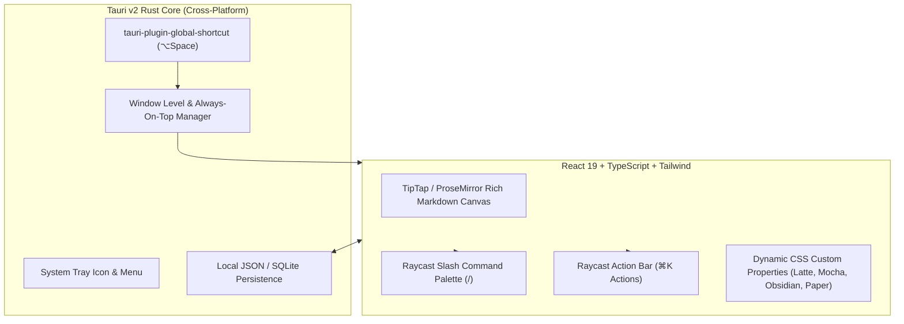

# FloatNotes Design System & Architectural Blueprint

<!-- impeccably designed with emilkowalski/skills & impeccable -->

## 1. Executive Summary & Vision

FloatNotes is an ultra-fast, cross-platform floating desktop notes app inspired by **Raycast Floating Notes**. It delivers frictionless, muscle-memory capture directly on top of whatever workspace you are in—without context switching to heavyweight tools like Notion or Obsidian.

---

## 2. The Multi-Theme Catalog (Including Full Light & Dark Modes)

FloatNotes ships with a curated built-in theme engine supporting dark themes, frosted glass, and **first-class light mode support** (such as Catppuccin Latte and Raycast Paper).

| Theme Name | Mode | Base Background | Surface / Card | Accent | Personality |
| :--- | :--- | :--- | :--- | :--- | :--- |
| **Raycast Obsidian** | Dark | `#0D0F12` (88% glass) | `#161A20` | `#FF6363` (Coral Red) | Pitch-black HUD, sub-pixel borders, iconic Raycast aesthetic |
| **Catppuccin Mocha** | Dark | `#1E1E2E` (90% glass) | `#313244` | `#CBA6F7` (Mauve) | Developer community darling, soothing pastel tones |
| **Catppuccin Latte** | **Light ☀️** | `#EFF1F5` (92% glass) | `#E6E9EF` | `#8839EF` (Latte Mauve) | Warm off-white paper canvas, deep slate ink, zero eye-strain |
| **Raycast Paper** | **Light ☀️** | `#FFFFFF` (94% glass) | `#F8FAFC` | `#E11D48` (Crimson) | Crisp architectural office paper, high typographic contrast |
| **Spatial Sonoma** | Dark Glass | `#1C1E24` (75% acrylic) | `#2D313A` | `#38BDF8` (macOS Cyan) | Heavy frosted glass, multi-layer specular rims |
| **Linear Monastic** | Dark Slate | `#121316` (96% solid) | `#1B1D22` | `#10B981` (Emerald) | Ultra-minimal, distraction-free markdown retreat |

---

## 3. Light Mode Contrast & Craft Rules

Following `impeccable` and `emil-design-eng` principles:

1. **Ink Contrast Floor:**
   - In light mode, text must never wash out against warm or white backgrounds. Primary body text uses deep high-contrast slate (`#0F172A` in Paper, `#4C4F69` in Latte), with secondary text at minimum 4.5:1 WCAG AA contrast (`#475569` / `#6C6F85`).
2. **Sub-Pixel Borders for Light Glass:**
   - Dark mode uses `rgba(255, 255, 255, 0.1)`.
   - Light mode uses crisp tinted borders `rgba(140, 143, 161, 0.25)` or `rgba(226, 232, 240, 0.9)` paired with an inner specular highlight `inset 0 1px 0 rgba(255, 255, 255, 0.8)`.
3. **Double-Layer Elevation:**
   - In light mode, harsh dark shadows look muddy. We use diffuse ambient shadows:
     ```css
     box-shadow: 0 20px 50px -10px rgba(76, 79, 105, 0.18), 0 0 0 1px rgba(140, 143, 161, 0.2);
     ```

---

## 4. Core Feature Architecture (Raycast Parity)

### 4.1. Floating & Desktop Pinning
- **"Always on Top" Pin**: Toggleable pin button in titlebar and shortcut `⌥P`. When pinned, the window floats above all applications (including full-screen apps on macOS via `NSStatusWindowLevel`).
- **Workspace Ubiquity**: Configured with `set_visible_on_all_workspaces(true)` to follow monitor/space changes seamlessly.
- **Direct Manipulation Drag**: Smooth `data-tauri-drag-region` on the top bar with pointer capture.

### 4.2. Raycast-Style Slash Command Menu (`/`)
- Triggered by typing `/` on an empty line or after a space.
- Floating command palette positioned right at the cursor.
- Instant search filter and keyboard navigation (`↑`, `↓`, `↵`, `Esc`).
- Supported blocks:
  - `/todo` &bull; Clickable interactive checkbox checklist
  - `/h1`, `/h2`, `/h3` &bull; Typography hierarchy headers
  - `/bullet` &bull; Unordered bullet list
  - `/code` &bull; Syntax-highlighted code block with language indicator
  - `/callout` &bull; Framed thought box with emoji pill
  - `/quote` &bull; Markdown blockquote
  - `/divider` &bull; Horizontal hairline rule
  - `/timestamp` &bull; Insert formatted current date/time

### 4.3. Raycast Bottom Action Bar & Command Palette (`⌘K`)
- **Status Metadata**: Left-aligned word count, character count, and discrete sync indicator ("Synced to disk").
- **`⌘K Actions` Button**: Pops up the action palette:
  - Copy Markdown to Clipboard (`⌘C`)
  - Pin / Unpin Float (`⌥P`)
  - Change Theme (`⌥T`) &bull; Instantly switch between Obsidian, Mocha, Latte, Paper, Sonoma, Monastic
  - New Note (`⌘N`)
  - Clear Note (`⌘⌫`)
  - Export to File (`⌘E`)

### 4.4. Multi-Note Quick Switcher
- Fast note tabs in the top bar with `⌘1` .. `⌘9` hotkeys.
- Rapid note switching without lag.

---

## 5. Emil Kowalski Animation & Polish Guidelines

Applied strictly from `emilkowalski/skills`:

1. **Zero-Latency Keyboard Summoning:**
   - Raycast has **no opening or closing animation**. For an action repeated 100+ times a day via global hotkey (`⌥Space`), any fade or scale animation adds perceived lag. The window appears instantaneously.
2. **Intentional Easing Curves:**
   ```css
   /* Raycast quick-out for UI popovers and menus */
   --ease-raycast: cubic-bezier(0.23, 1, 0.32, 1);
   /* Apple momentum spring */
   --ease-spring: cubic-bezier(0.175, 0.885, 0.32, 1.15);
   ```
3. **Press Response (`:active`):**
   - All interactive buttons immediately drop to `transform: scale(0.96)` on pointer-down with 80ms transition, providing tactile feedback before the click triggers.
4. **Slash Command Popover:**
   - Scales from `scale(0.95); opacity: 0` to `scale(1); opacity: 1` over 140ms with `cubic-bezier(0.23, 1, 0.32, 1)`.

---

## 6. Technical Stack for Cross-Platform Desktop (Tauri v2)



- **Backend**: Rust + Tauri v2 (`@tauri-apps/api`, `tauri-plugin-global-shortcut`, `tauri-plugin-clipboard-manager`, `tauri-plugin-fs`).
- **Frontend**: React 19 + TypeScript + Tailwind CSS + TipTap / ProseMirror + Lucide icons.
- **macOS specifics**: Native vibrancy (`NSVisualEffectView`, `NSStatusWindowLevel`).
- **Windows specifics**: Mica / Acrylic background via Tauri window attributes.
- **Linux specifics**: Transparent composite window support.
