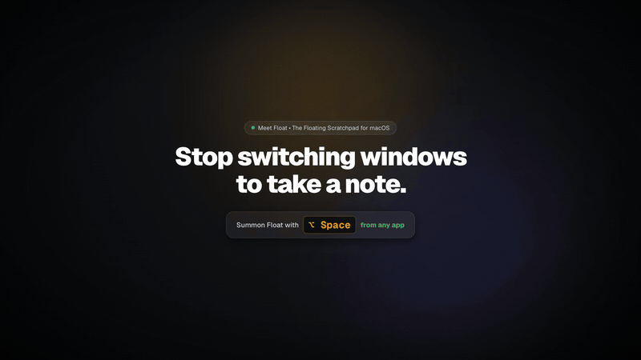

<div align="center">


# Float

A floating desktop scratchpad for macOS that lives on a hotkey.<br/>
Press `⌥ Space` over any app, jot it down, press `Esc`. Notes save as plain Markdown files.

**[Download for macOS](https://github.com/Rohithgilla12/float/releases/latest)** · [Website](https://float.gilla.fun) · [15s film](https://float.gilla.fun/float-intro.mp4)

<sub>Free and MIT licensed · Universal binary, signed and notarised · macOS 11 or later · Optional $4.99 Pro unlock</sub>

<br/>



</div>

---

## ✨ Key Features

- **Desktop Floating & Pinning**: 
  - Borderless translucent floating glass panel.
  - Toggleable **"Always on Top"** desktop pinning (`⌥P`), keeping your scratchpad floating above full-screen editors, Figma, or browsers.
  - Multi-workspace ubiquity on macOS (`set_visible_on_all_workspaces(true)`).
  - Smooth window dragging via `data-tauri-drag-region`.
- **Global Hotkey Summoning**:
  - Press `⌥ + Space` (Option+Space or Alt+Space) anywhere on your system to instantly summon or dismiss your floating scratchpad.
- **Unified Live WYSIWYG Editor**:
  - Always in rendered preview mode—zero clunky "edit vs preview" toggle.
  - Interactive clickable checkboxes with fluid spring tick and strikethrough.
  - Auto-formatting as you type (`# `, `## `, `### `, `[] `, `- `, `> `).
- **Native Local File Storage (`.md`)**:
  - Automatically saves notes to local disk at `~/Documents/Float` (or your custom directory).
  - Pure raw Markdown files readable directly by Obsidian, VS Code, iA Writer, or Finder with zero lock-in.
  - Native macOS folder picker in Settings.
- **Instant Slash Commands (`/`)**:
  - Type `/` anywhere to reveal the fuzzy-searchable command menu.
  - Insert `/todo`, `/h1`..`/h3`, `/code`, `/callout`, `/quote`, `/bullet`, `/divider`, `/timestamp`.
- **Sensory Polish & Tactile Haptics**:
  - **Synthesized Web Audio Micro-Haptics:** Real-time tactile mechanical clicks for task checks, key presses, and shortcuts via `AudioContext`.
  - **Sub-Pixel Specular Glass Shader:** Real-time cursor coordinates track along the 1px border, casting a specular light sheen.
  - **Task Particle Bursts:** 60 FPS micro sparkles radiate when completing checklist items.
  - **Fluid Morphing Palette:** The `⌘K` command sheet springs smoothly from the trigger origin.
- **Settings & Shortcut Customization (`⌘,`)**:
  - Dedicated Settings modal with 4 intuitive panels:
    - **Storage & Files**: Choose your disk directory, reveal in Finder, toggle auto-save.
    - **Shortcuts**: View and customize keyboard shortcuts for note lifecycle.
    - **License & Pro**: Manage Float Pro lifetime license via Dodo Payments.
    - **Appearance**: One-click theme switching with live preview chips.
- **Multi-Theme Engine with First-Class Light Mode ☀️**:
  - **Obsidian HUD** (Dark): Pitch-black HUD, sub-pixel glass borders, coral-red accent glow.
  - **Catppuccin Mocha** (Dark): Soothing low-contrast pastel midnight theme.
  - **Catppuccin Latte** (Light): Warm daytime off-white paper canvas with lavender Mauve accents.
  - **Editorial Paper** (Light): High-contrast architectural office white with crisp typography.
  - **Spatial Sonoma** (Glass): macOS frosted acrylic glass with specular reflections.
  - **Linear Monastic** (Slate): Ultra-clean, distraction-free markdown retreat.
- **Multi-Tab Note Lifecycle**:
  - Header note tabs with `+` button.
  - Switch notes with `⌘1` .. `⌘9` or `⌘[` / `⌘]`.
  - Create note with `⌘N` / `⌘T`.
  - Close active note tab with `⌘W`.

---

## ⌨️ Keyboard Shortcuts

| Shortcut | Action |
| :--- | :--- |
| `⌥ + Space` | Summon / Dismiss Floating Note anywhere on system |
| `⌘,` | Open Settings & Keybinds Modal |
| `⌘N` / `⌘T` | Create a New Note Tab |
| `⌘W` | Close Active Note Tab |
| `⌘[` / `⌘]` | Switch to Previous / Next Note Tab |
| `⌘1` .. `⌘9` | Quick-switch directly to Note 1 through 9 |
| `⌘K` / `⌘O` | Open Actions Command Palette / Switcher |
| `⌥P` | Toggle Pin on Desktop (Always on Top) |
| `/` | Trigger Slash Command Menu |
| `⌘C` | Copy Note Markdown to Clipboard |
| `⌘E` | Export Note to `.md` File |
| `Esc` | Dismiss open menus / popovers, or hide window |

---

## 🛠️ Development & Building

Float is built with Tauri v2 (Rust), React, TypeScript, and Tailwind CSS.

### Prerequisites
- Node.js (v18+)
- Rust & Cargo (1.80+)

### Start Desktop App in Development
```bash
npm run tauri dev
```

### Build Production Desktop Binary (.dmg / .app)
```bash
npm run tauri build
```

---

## 💰 Free app, $4.99 Pro unlock

- The code is **100% open source** under the [MIT License](LICENSE).
- The signed, notarised `.dmg` is free to download from [Releases](https://github.com/Rohithgilla12/float/releases/latest) and updates itself.
- The free app has the full editor, the global hotkey, and pinning, with 3 note tabs and two themes (Obsidian HUD and Catppuccin Latte).
- **Float Pro** ($4.99 once, via **Dodo Payments**) unlocks all six themes, unlimited note tabs, image cards, ghost mode, zen mode, and a custom notes folder.

See [`MONETIZATION_AND_SIGNING.md`](MONETIZATION_AND_SIGNING.md) for the complete Apple signing, notarization, and Dodo Payments integration guide.

---

## 🤝 Contributing

Contributions are welcome! Please read [`CONTRIBUTING.md`](CONTRIBUTING.md) before opening a pull request.
